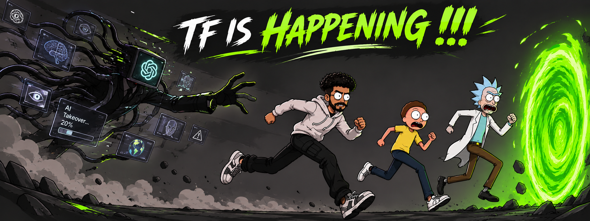
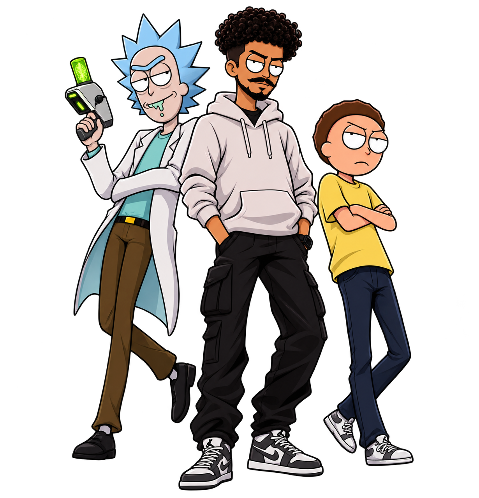

 

---

<table>
<tr>
<td width="38%" align="center" valign="top">
  
</td>
<td width="62%" valign="top">

## WHO AM I?

I'm a **Computer Science student at Mekelle University**, passionate about technology and building things that solve real-world problems.

My interests revolve around **Web Development, Artificial Intelligence, and IoT & Embedded Systems**. I enjoy turning ideas into working projects, exploring new technologies, and understanding how things work beyond the surface.

I'm particularly interested in exploring how AI can be used to create practical, intelligent solutions. I also enjoy experimenting with different tools, learning by building, and challenging myself with projects that push my technical abilities.

I believe there's always something new to learn, something better to build, and another problem worth solving.

</td>
</tr>
</table>

**STILL LEARNING. STILL BUILDING. ALWAYS EXPERIMENTING.**

---

## ⚠️ A LITTLE REMINDER

> Code is never finished. It only gets better.  
> What you see here is built with practice, curiosity, and persistence.

---

## MY CONTRIBUTIONS

---

## MY TECH STACK

### Languages

### Frontend & Backend

### Tools & Platforms

**Areas I'm exploring:** Artificial Intelligence · IoT · Embedded Systems · Cybersecurity

---

## SOME THINGS I'VE BEEN BUILDING

<table>
<tr>
<td width="50%" valign="top">

### [MorphDrive 3D](https://github.com/Faniel-7/morphdrive-3d)

Interactive 3D vehicle experience controlled with real-time hand tracking.

<code>3D</code> <code>Computer Vision</code> <code>Hand Tracking</code>

</td>
<td width="50%" valign="top">

### [Liq](https://github.com/Faniel-7/Liq)

An offline, local AI assistant project built to bring a personal Jarvis-like experience to the desktop.

<code>Python</code> <code>AI</code> <code>Offline</code>

</td>
</tr>
<tr>
<td width="50%" valign="top">

### [GreenGo Menu App](https://github.com/Faniel-7/GreenGo-Menu-App)

A digital restaurant menu experience designed to make browsing and managing menus easier.

<code>Web App</code> <code>Restaurant Tech</code>

</td>
<td width="50%" valign="top">

### [2AM: Bunk Bed Disaster](https://github.com/Faniel-7/2am-bunk-bed-disaster)

A 2D cartoon comedy game with chaotic late-night gameplay.

<code>Game Development</code> <code>2D</code> <code>JavaScript</code>

</td>
</tr>
<tr>
<td width="50%" valign="top">

### [Ride App — Frontend](https://github.com/sophortechnologies/RideApp_Frontend)

Collaborative frontend development for a ride-hailing platform during my industry experience.

<code>React</code> <code>TypeScript</code> <code>Frontend</code>

</td>
<td width="50%" valign="top">

### [Music Generator](https://github.com/Faniel-7/Music-Generator)

An LSTM-based music generation project experimenting with neural networks and MIDI.

<code>Python</code> <code>TensorFlow</code> <code>LSTM</code> <code>MIDI</code>

</td>
</tr>
</table>

---

## GITHUB AT A GLANCE

 

---

### THANKS FOR STOPPING BY

**Curiosity got us here. Building takes us further.**

